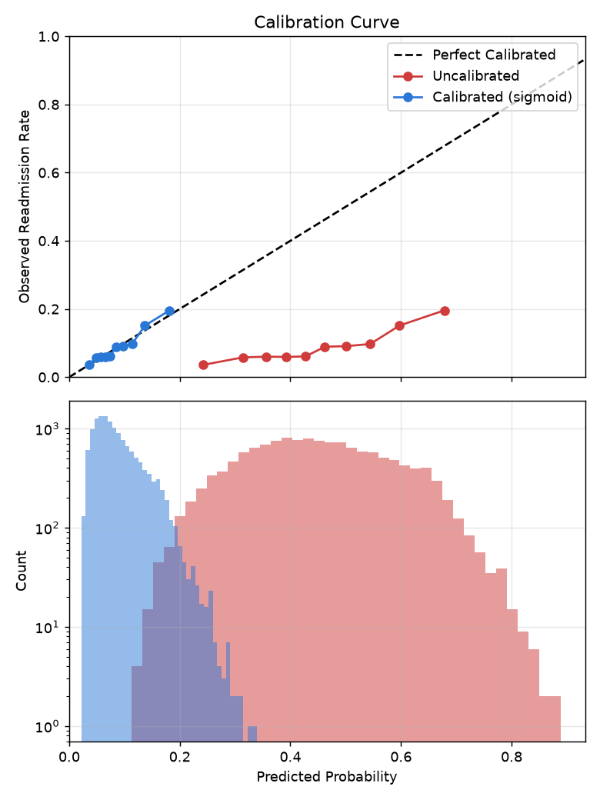
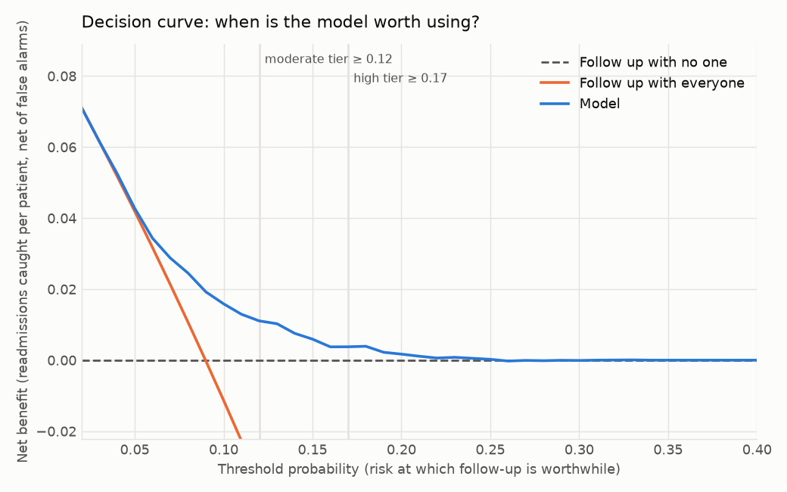
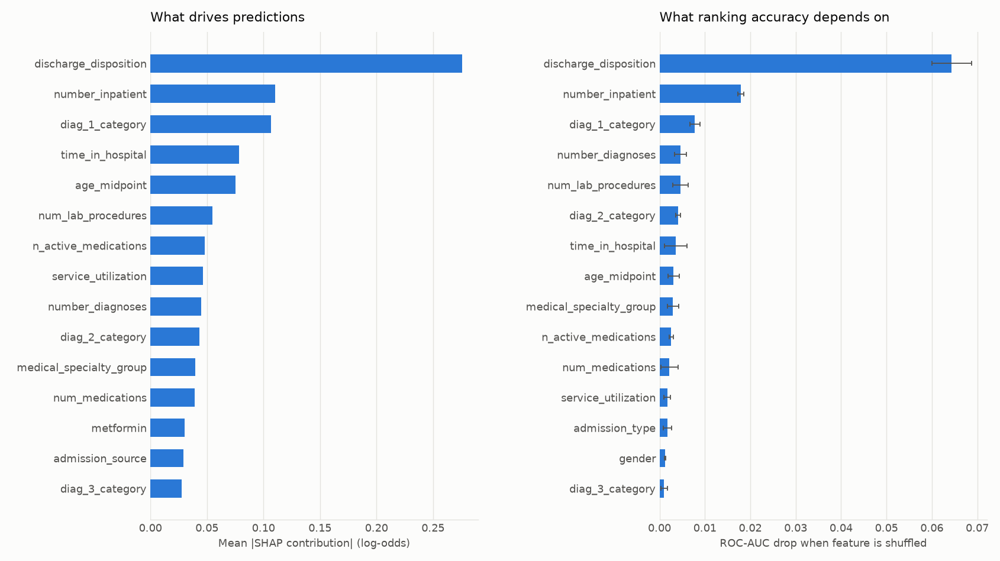

# Model Card: 30-Day Readmission Risk (Diabetes Cohort)

> **Not validated for clinical use.** This is a portfolio project trained on public data from 1999–2008. It demonstrates how such a model should be built, evaluated, and documented; it has not been externally or prospectively validated.

All figures below come from the training run of **2026-11-13** (model version 0.1.0) on a held-out test set of **13,998 patients**. To regenerate them, run `uv run python -m readmission.train`; full results are written to `models/metrics.json`.

## At a glance

| | |
|---|---|
| **Predicts** | Probability that a diabetic inpatient is readmitted within 30 days of discharge |
| **When** | At discharge (requires discharge disposition) |
| **Output** | Calibrated risk (highest on the test set: 33.9%) and a risk tier: high / moderate / low |
| **Use it to** | Prioritize a discharge follow-up list: who gets intensive follow-up, who gets a lighter-touch check-in |
| **Do not use it to** | Withhold or ration care, make coverage or payment decisions, or as a diagnosis for an individual patient |
| **Performance** | ROC-AUC 0.649; the high tier (5.5 per 100 discharges) is readmitted at 22.7%, vs 6.9% in the low tier |
| **Biggest caveats** | Modest discrimination; 1999–2008 data using ICD-9 codes; not externally validated |

## Model details

- **Algorithm:** XGBoost gradient-boosted trees inside a scikit-learn pipeline (imputation, scaling, and one-hot encoding are fit inside the pipeline, so cross-validation has no leakage). Class weighting handles the 9% positive rate.
- **Selection:** compared against class-weighted logistic regression with 5-fold cross-validation (CV ROC-AUC 0.645 vs 0.640 before tuning), then tuned with a 30-trial randomized search (best CV ROC-AUC 0.650). Chosen hyperparameters: max depth 5, learning rate 0.0135, 522 trees, subsample 0.84, column sample 0.78, min child weight 24.
- **Calibration:** sigmoid (Platt) scaling on a held-out calibration split. Isotonic calibration was tried first and replaced: its top steps were fit on a handful of patients, one of which produced 100% risk predictions.
- **Inputs (26):** age, length of stay, lab/procedure/medication/diagnosis counts, prior-year outpatient/emergency/inpatient visits, gender, admission type and source, discharge disposition, admitting specialty, primary/secondary/tertiary diagnosis group (ICD-9 chapter), glucose and HbA1c test results, insulin and metformin status, medication-change flags. Full list: `NUMERIC_FEATURES` and `CATEGORICAL_FEATURES` in `src/readmission/preprocessing.py`.
- **Not an input:** race. See [Ethical considerations](#ethical-considerations).
- **Code:** training in `src/readmission/train.py`; every design decision is recorded in `notebooks/01_eda.ipynb` and `src/readmission/config.py`.

## Intended use

**Primary use:** at discharge, score each diabetic inpatient and sort them into tiers so a care team with limited capacity follows up with the patients most likely to be readmitted.

**Intended users:** discharge-planning and care-transition teams, who see the tier and risk alongside their own clinical judgment.

**Out of scope:**
- **Denying, delaying, or rationing care.** A low tier means *lower predicted risk*, not *no risk*: low-tier patients are still readmitted at 6.9%.
- **Insurance, coverage, or payment decisions.**
- **Scoring before discharge.** The strongest input, discharge disposition, isn't known until then.
- **Patients outside the training population:** non-diabetic patients, children, patients who died or were discharged to hospice, or hospitals and eras that differ substantially from 1999–2008 US practice.
- **Data coded in ICD-10** (the US standard since October 2015) without first remapping diagnosis codes to the groups used here.

## Training and evaluation data

- **Source:** [UCI Diabetes 130-US Hospitals, 1999–2008](https://archive.ics.uci.edu/dataset/296/diabetes+130-us+hospitals+for+years+1999-2008) (Strack et al., 2014). Public and de-identified.
- **Cohort:** 101,766 encounters → **69,987 patients**, keeping each patient's first encounter only (so no patient appears in both training and test) and excluding discharges to hospice or death (they cannot be readmitted) and records with unknown gender.
- **Label:** readmitted within 30 days (`<30`) = 1, otherwise 0. **Positive rate: 9.0%.**
- **Splits (stratified, fixed seed):** 80% training (55,989) / 20% test (13,998). The training set is split again 80/20 into a fit split (model training) and a calibration split. The test set is used only for final scoring. Tier thresholds were chosen on the calibration split, not the test set.

## Performance

### Headline metrics (test set)

| Metric | No-skill baseline | Incumbent rule¹ | **Model** |
|---|---|---|---|
| ROC-AUC | 0.500 | 0.552 | **0.649** |
| PR-AUC | 0.090 | 0.116 | **0.162** |
| Lift in top 10% | 1.00× | 1.81× | **2.18×** |
| Brier score | 0.0817 | – | **0.0795** |
| Log loss | 0.302 | – | **0.290** |
| Expected calibration error | – | – | **0.009** |

¹ Rank patients by number of prior-year inpatient visits: what a hospital could do without a model.

- **Ranking:** the top 10% of patients by risk are readmitted at 19.6% (2.2× the base rate); the top 5% at 23.7% (2.6×).
- **Calibration:** predicted risks match observed rates (ECE 0.009). Calibration is essential here: class weighting pushes the raw model's scores far above real risk (uncalibrated ECE 0.362, Brier 0.218, worse than predicting the base rate for everyone).

### Risk tiers

Cutoffs are sized to follow-up capacity rather than picked as round numbers: roughly 6 per 100 discharges for intensive follow-up and about 22 per 100 in total.

| Tier | Predicted risk | Patients per 100 discharges | Observed readmission rate |
|---|---|---|---|
| **High** | ≥ 0.17 | 5.5 | 22.7% |
| **Moderate** | 0.12 – 0.17 | 16.2 | 14.4% |
| **Low** | < 0.12 | 78.3 | 6.9% |

Following up with high + moderate (21.7 per 100) catches **39.9% of readmissions**, at about **6 patients contacted per readmission among them**.

**Decision curve:** the model gives more net benefit than following up with everyone or with no one for threshold probabilities from about 0.04 to 0.24, and both tier cutoffs sit inside that range.

## What drives predictions

Both methods agree on the top drivers, and all of them are known at discharge (no sign of leakage).

| Rank | Feature | Effect on predicted risk |
|---|---|---|
| 1 | Discharge disposition | Highest when transferred to another facility; lowest when discharged home |
| 2 | Prior-year inpatient visits | More visits → higher risk |
| 3 | Primary diagnosis group | Highest for circulatory; lowest for musculoskeletal |
| 4 | Length of stay | Longer stay → higher risk |
| 5 | Age | Older → higher risk |

- Discharge disposition dominates: shuffling it costs 0.064 ROC-AUC, about 43% of the model's skill above chance.
- Medication-change flags, insulin status, and the HbA1c result add no measurable ranking accuracy (the HbA1c finding is notable, since the source paper studied it).
- Contributions are SHAP values on the pre-calibration score; calibration is monotone, so rankings and directions carry over.
- **Per patient:** the API returns the top 3 factors behind each score, with plain-language labels. They describe what the model reacts to, **not clinical causes**. For example, an HbA1c result above 8 *lowers* predicted risk, likely because patients who were tested at all received more attentive diabetes care, which is the source paper's finding. A high HbA1c is not protective. Care teams should use the factors to understand and sanity-check a score, not as treatment guidance.

## Fairness evaluation

Performance by patient group on the test set, with "flagged" meaning predicted risk ≥ 0.12 (the moderate tier or higher, i.e. anyone the policy sends to follow-up). ROC-AUC intervals are bootstrap 95% CIs. Groups marked * have fewer than 30 readmissions, so their numbers are noisy.

**Race**

| Group | Patients | Observed rate | Mean predicted | ROC-AUC (95% CI) | Flagged | Readmissions flagged (recall) |
|---|---|---|---|---|---|---|
| Caucasian | 10,522 | 9.1% | 9.1% | 0.638 (0.62–0.66) | 22.8% | 39.7% |
| African American | 2,504 | 9.2% | 8.5% | 0.667 (0.63–0.70) | 18.3% | 35.9% |
| Hispanic | 286 | 10.5% | 8.5% | 0.696 (0.58–0.80) | 18.5% | 50.0% |
| Missing* | 361 | 6.1% | 8.7% | 0.744 (0.63–0.85) | 22.4% | 63.6% |
| Other* | 229 | 4.8% | 8.0% | 0.806 (0.68–0.91) | 16.6% | 54.5% |
| Asian* | 96 | 9.4% | 8.1% | 0.779 (0.61–0.92) | 14.6% | 44.4% |

**Gender**

| Group | Patients | Observed rate | Mean predicted | ROC-AUC (95% CI) | Flagged | Recall |
|---|---|---|---|---|---|---|
| Female | 7,507 | 8.8% | 9.0% | 0.653 (0.63–0.67) | 22.9% | 41.3% |
| Male | 6,491 | 9.1% | 8.9% | 0.645 (0.62–0.67) | 20.4% | 38.3% |

**Age**

| Group | Patients | Observed rate | Mean predicted | ROC-AUC (95% CI) | Flagged | Recall |
|---|---|---|---|---|---|---|
| < 50 | 2,231 | 6.7% | 6.8% | 0.669 (0.63–0.72) | 9.5% | 25.5% |
| 50–69 | 5,591 | 8.4% | 8.2% | 0.638 (0.61–0.66) | 15.9% | 30.9% |
| 70–79 | 3,606 | 10.5% | 10.1% | 0.644 (0.61–0.67) | 28.3% | 47.9% |
| 80+ | 2,570 | 10.2% | 10.8% | 0.632 (0.60–0.67) | 35.7% | 52.5% |

## Ethical considerations

- **Race is not a model input; it is kept only for these audits.** It added ~0.0015 ROC-AUC, and current clinical-modeling practice avoids race as a predictor without a specific justification. Removing it left cross-validated ROC-AUC unchanged (0.650) and barely moved the gaps between race groups. Removing an input does not make a model fair by itself, since other features can act as proxies, which is why the audit above is part of every training run.
- **African American patients are flagged less often at the same observed risk.** They are readmitted at the same rate as Caucasian patients (9.2% vs 9.1%) but predicted slightly lower (8.5%), so fewer are flagged (18.3% vs 22.8%) and fewer of their readmissions are caught (35.9% vs 39.7%). The recall gap is about 1.2 standard errors, so it is not conclusive on this test set, but it points in a consistent direction and is the **top monitoring priority**. Hispanic patients show a similar under-prediction (8.5% predicted vs 10.5% observed) on a smaller sample. If the gap is confirmed on more data, options include features that capture the missing risk drivers, or group-aware recalibration (which would reintroduce race into the scoring step, a trade-off that needs explicit sign-off).
- **One shared list favors older patients, by design.** The model is well calibrated within every age band, but younger patients genuinely have lower risk (6.7% vs ~10%), so a single cutoff flags far fewer of them: only a quarter of under-50 readmissions are caught, vs half for 80+. A program that wants to reach younger patients should add a separate outreach path rather than trust this list alone.
- **Gender:** no material difference.
- **Human in the loop:** the tier should inform a care team's prioritization, not replace clinical judgment, and it should never be used to reduce care.

## Limitations

- **Old data and old codes.** Encounters are from 1999–2008. Care patterns have changed since, and US hospitals switched from ICD-9 to ICD-10 diagnosis codes in 2015, so diagnosis grouping would need remapping. Any real use requires retraining or at least validating on current local data.
- **The label is broad.** It counts any readmission within 30 days recorded in the source data. It doesn't distinguish planned from unplanned readmissions, and readmissions to hospitals outside the source database may be missed.
- **The strongest signal needs scrutiny.** "Transferred to another facility" is the highest-risk discharge category. If some transfers to another hospital are recorded as readmissions, part of that signal is a recording artifact rather than patient risk. The dataset documentation doesn't resolve this.
- **Modest discrimination.** ROC-AUC 0.65 is consistent with published work on this dataset, which lacks social, functional, and post-discharge data. The model concentrates risk usefully (2.2× lift in the top 10%) but misses most readmissions: high + moderate catch 40%.
- **One test split, same hospitals and era.** There's no temporal or external validation. The performance above is an optimistic estimate of performance at a new site.
- **Small subgroups.** Asian, Other, and missing-race groups have too few readmissions for firm conclusions.
- **Thresholds are tied to this model.** Tier cutoffs depend on the calibration method and on each trained model; they must be re-checked after every retrain.

## Monitoring and maintenance

Outcomes arrive 30 days after each prediction, so input-based checks run continuously and outcome-based checks run on matured cohorts.

| What | How often | Action threshold (example) |
|---|---|---|
| Patients per tier per 100 discharges | Weekly | High tier outside 4–8, or high + moderate outside 18–26 → investigate input drift or calibration |
| Input mix (discharge disposition, prior inpatient visits, diagnosis groups) | Weekly | Large shift from the training distribution → check before trusting tiers |
| Observed vs predicted readmission rate per tier | Monthly, 30+ days after discharge | Tier rates drifting outside their training ranges → recalibrate |
| Subgroup calibration gap and recall (race, gender, age) | Quarterly | African American / Hispanic recall or calibration gap growing → escalate (see Ethical considerations) |

**On every retrain:** rerun the full evaluation (subgroups, explainability, capacity, decision curve), re-derive tier cutoffs on the calibration split, confirm the highest predicted risk is plausible, and update this card. The release pipeline enforces the automatable part: a model is only published if it passes the quality gate in `src/readmission/quality_gate.py` (performance floors, beating the incumbent rule, tier volumes within the ranges above, and subgroup calibration gaps within limits).

## References

- Strack, B., et al. (2014). Impact of HbA1c Measurement on Hospital Readmission Rates: Analysis of 70,000 Clinical Database Patient Records. *BioMed Research International.*
- Mitchell, M., et al. (2019). Model Cards for Model Reporting. *Proceedings of FAT\* 2019.*
- Vickers, A. J., & Elkin, E. B. (2006). Decision curve analysis: a novel method for evaluating prediction models. *Medical Decision Making.*
